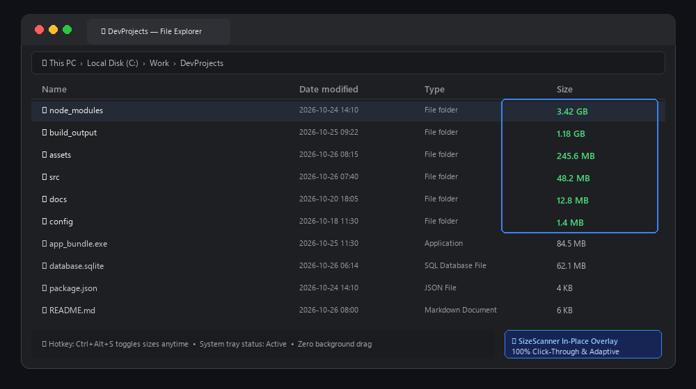
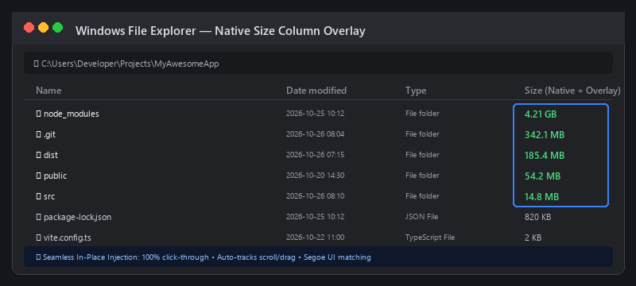
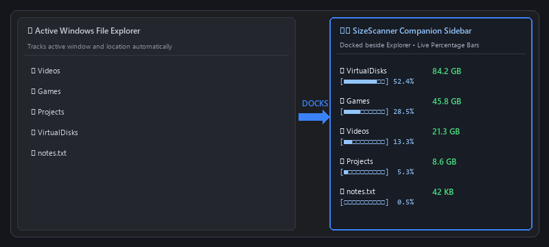
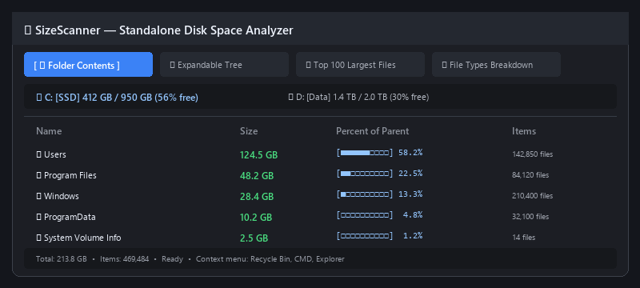
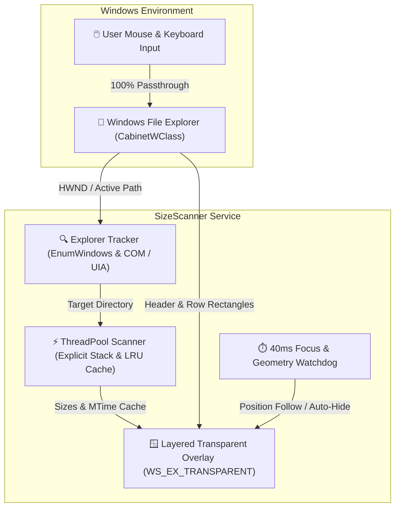

<div align="center">


# SizeScanner

**In-Place Windows File Explorer Folder Sizes & Disk Space Analyzer**

*Seamlessly filling in the blank folder sizes directly inside Windows File Explorer's native "Size" column — click-through, adaptive, and lightning fast.*

<p>
  <a href="LICENSE"></a>
  
  
  
  
  
</p>

---

<p>
  <a href="#about-sizescanner">About</a> •
  <a href="#key-features">Features</a> •
  <a href="#visual-tour">Visual Tour</a> •
  <a href="#how-it-works">How It Works</a> •
  <a href="#three-modes">Modes</a> •
  <a href="#quick-start">Quick Start</a> •
  <a href="#shortcuts-and-tray">Shortcuts & Tray</a> •
  <a href="#configuration">Configuration</a> •
  <a href="#building-and-testing">Building & Testing</a> •
  <a href="#license-and-credits">License</a>
</p>

<picture>
  
</picture>

</div>

---

<a id="about-sizescanner"></a>
## ⚡ About SizeScanner

In standard Windows File Explorer Details view, individual files display exact sizes (e.g., `84.5 MB`, `62 KB`), but **folder sizes are always left blank**. Finding which directory consumes your disk space traditionally meant opening folder properties one-by-one or launching heavy, separate disk inspection tools.

**SizeScanner solves this natively in File Explorer.**

Instead of forcing you into a disconnected third-party interface, SizeScanner acts as an intelligent companion layer: it tracks the directory you are viewing, calculates subfolder sizes concurrently in the background, and **projects those sizes right into the blank space of Windows File Explorer's native "Size" column**.

- 🎯 **Native In-Place Integration**: Folder sizes appear naturally in Explorer's own list view, aligned with existing file sizes.
- 🖱️ **100% Click-Through & Transparent**: Powered by Windows layered extended styles (`WS_EX_LAYERED | WS_EX_TRANSPARENT`). Click, double-click, drag files, select rows, right-click, and scroll without any interference or input capture.
- 🎨 **Adaptive Style & Dark Mode**: Automatically detects Windows Light/Dark mode (`AppsUseLightTheme`), window DPI scaling, and active Segoe UI font metrics to match Explorer pixel-for-pixel.
- ⚡ **High Performance & Low Latency**: Win32 window discovery runs in under 1ms, background multithreaded scanning publishes progressive results in real time, and instant LRU caching makes navigation feel immediate.
- 🛡️ **Local-First & Offline**: Completely self-contained with zero network calls, zero telemetry, and zero tracking.

---

<a id="key-features"></a>
## 🌟 Key Features

<table>
  <tr>
    <td width="50%">
      <h3>⚡ Native In-Place Explorer Overlay</h3>
      <p>Draws folder sizes directly into File Explorer's native Details view. Sits unobtrusively in your system tray and disappears the instant Explorer loses focus.</p>
    </td>
    <td width="50%">
      <h3>🗂️ Docked Companion Sidebar</h3>
      <p>Need a deeper breakdown? Snap a companion sidebar directly to the edge of your active File Explorer window, tracking your navigation with live visual percent bars.</p>
    </td>
  </tr>
  <tr>
    <td width="50%">
      <h3>📊 Standalone Multi-Tab Disk Analyzer</h3>
      <p>Launch a full-featured disk utility with interactive Folder Contents, Expandable Tree, Top 100 Largest Files, and File Types Breakdown charts.</p>
    </td>
    <td width="50%">
      <h3>⌨️ Instant Global Hotkey Toggle</h3>
      <p>Toggle sizes on or off on the fly using <code>Ctrl+Alt+S</code> (fully customizable). When disabled, background tracking completely halts with zero CPU overhead.</p>
    </td>
  </tr>
  <tr>
    <td width="50%">
      <h3>🎨 Dynamic DPI &amp; Font Matching</h3>
      <p>Measures Explorer's row padding and active text color on startup, adapting effortlessly to custom themes, high-DPI displays, and theme switches.</p>
    </td>
    <td width="50%">
      <h3>🚀 Multithreaded Engine with Cancel Tokens</h3>
      <p>Background <code>ThreadPoolExecutor</code> scans directories recursively without locking the UI. Navigation instantly cancels obsolete tasks via tokenized operations.</p>
    </td>
  </tr>
</table>

---

<a id="visual-tour"></a>
## 📸 Visual Tour

### 1. Native In-Place Explorer Overlay
Subfolder sizes render automatically in Explorer's blank "Size" column. All mouse and keyboard clicks pass directly through to Explorer windows.

<p align="center">
  
</p>

### 2. Docked Companion Sidebar
A sleek sidebar that snaps to the right side of the active File Explorer window, showing visual space consumption bars and subfolder counts as you navigate.

<p align="center">
  
</p>

### 3. Standalone Multi-Tab Disk Space Analyzer
Comprehensive disk inspection with quick drive selector, expandable tree navigation, top 100 space hogs, file extension categorization, and Recycle Bin integration.

<p align="center">
  
</p>

---

<a id="how-it-works"></a>
## ⚙️ How It Works Under the Hood

SizeScanner combines lightweight Win32 system APIs with non-blocking UIAutomation probes and multithreaded scanning:



### Core Architecture Highlights:
- **Zero-Latency Input Passthrough**: The overlay window applies `WS_EX_LAYERED | WS_EX_TRANSPARENT | WS_EX_TOOLWINDOW` and `-transparentcolor`. Windows directs all clicks, wheel scrolls, drags, and hover states straight to File Explorer.
- **Fast Z-Ordered Window Discovery**: Window discovery uses raw Win32 `EnumWindows` (<1ms). Heavier COM/UIAutomation resolution only runs for the single active window.
- **Smart Drag Following**: A 40ms watchdog recalculates window delta offsets using fast Win32 `GetWindowRect`, following smooth window dragging without triggering heavy UIAutomation sweeps.
- **Per-Operation Cancel Tokens**: When you navigate into a different folder, the previous scan operation's `CancelToken` is immediately triggered, preventing stale background scans from overwriting current view data.
- **Two-Tier Size Caching**: Folder sizes are keyed by directory path, modification time (`mtime`), and time-to-live (`CACHE_TTL_SECONDS`), ensuring revisited directories display instantaneously.

---

<a id="three-modes"></a>
## 🖥️ Three Flexible Modes

SizeScanner provides three complementary interfaces powered by the same high-performance scanning engine:

| Mode | Command / Entry Point | Description | Ideal For |
| :--- | :--- | :--- | :--- |
| **In-Place Overlay** | `SizeScanner.exe`<br>*(default)* | Sits in the Windows system tray and renders folder sizes directly into File Explorer's Size column. | Everyday browsing without changing your workflow. |
| **Companion Sidebar** | `SizeScanner.exe --companion` | Docks a compact sidebar to the active File Explorer window with tree view and percentage bars. | Organizing messy directories alongside Explorer. |
| **Disk Analyzer** | `SizeScanner.exe --full`<br>*(or path argument)* | Standalone window with multi-tab analysis (Folder Contents, Tree, Top 100, File Types). | In-depth disk cleanup and storage auditing. |

---

<a id="quick-start"></a>
## 🚀 Installation & Quick Start

### Option 1: Standalone Executable (Recommended)

Run the pre-compiled standalone executable:

```powershell
dist\SizeScanner\SizeScanner.exe
```

Upon launching:
- SizeScanner minimizes to the Windows System Tray with a blue lightning icon.
- Open any folder in Windows File Explorer Details view — folder sizes will begin appearing automatically!

### Option 2: Desktop Shortcut & Batch Launcher

- Double-click `Run-SizeScanner.bat` in the repository root.
- To generate a convenient Desktop shortcut, run:
  ```powershell
  powershell -ExecutionPolicy Bypass -File .\Create-Desktop-Shortcut.ps1
  ```

### Option 3: Run from Python Source

Ensure dependencies are installed, then launch directly:

```powershell
# Default In-Place Overlay Service
python main.py

# Launch Docked Companion Sidebar
python main.py --companion

# Launch Standalone Disk Analyzer
python main.py --full

# Analyze a specific path directly
python main.py "D:\Projects"
```

---

<a id="shortcuts-and-tray"></a>
## ⌨️ Keyboard Shortcuts & System Tray

### Global Hotkey

| Shortcut | Action | Description |
| :---: | :--- | :--- |
| <kbd>Ctrl</kbd> + <kbd>Alt</kbd> + <kbd>S</kbd> | **Toggle SizeScanner** | Instantly toggles in-Explorer folder sizes on or off. State is persisted across reboots. |

> [!TIP]
> When toggled off, SizeScanner pauses all background scans and UI tracking completely, sitting dormant in the tray with zero CPU overhead.

### System Tray Controls

Right-click the blue ⚡ tray icon at any time to access:
- **Show sizes in Explorer**: Checkmark toggle for the in-place overlay (left-clicking the icon toggles this directly).
- **Open Companion Sidebar**: Launches the docked sidebar alongside Explorer.
- **Open Full Analyzer App**: Launches the standalone multi-tab disk analyzer.
- **Edit Settings…**: Opens the configuration file in your default editor.
- **Exit**: Quits SizeScanner cleanly.

---

<a id="configuration"></a>
## 🎨 Configuration

Settings are saved in your user profile:

```
%APPDATA%\SizeScanner\settings.json
```

### Configuration Options

```json
{
  "hotkey": "ctrl+alt+s",
  "start_enabled": true,
  "right_padding": null,
  "text_color_dark": null,
  "text_color_light": null
}
```

| Key | Type | Default | Description |
| :--- | :---: | :---: | :--- |
| `hotkey` | `string` | `"ctrl+alt+s"` | Global keyboard combination (e.g. `"ctrl+shift+f9"`, `"alt+home"`). Set to `""` to disable. |
| `start_enabled` | `boolean` | `true` | Whether folder sizes are enabled automatically when SizeScanner starts. |
| `right_padding` | `integer \| null` | `null` | Right-side column padding in pixels (`null` auto-measures Explorer's native padding). |
| `text_color_dark` | `string \| null` | `null` | Hex color for dark mode (`null` auto-detects Explorer's font color). |
| `text_color_light` | `string \| null` | `null` | Hex color for light mode (`null` auto-detects Explorer's font color). |

---

<a id="building-and-testing"></a>
## 🛠️ Building from Source & Testing

### Prerequisites

- **Windows 10** (build 19041+) or **Windows 11** (x64)
- **Python 3.10+**
- Required Python packages:
  ```powershell
  pip install pywin32 uiautomation customtkinter pystray Pillow psutil send2trash comtypes
  ```

### Compiling Executable with PyInstaller

Run the automated build script:

```powershell
python build_exe.py
```

The compiled standalone application will be packaged into:
```
dist/SizeScanner/SizeScanner.exe
```

### Running the Test Suite

SizeScanner includes an automated test suite covering the scanning engine, overlay geometry, live Explorer tracking, and hotkey parsing:

```powershell
# Core multithreaded scanning engine & cache test
python test_scanner.py

# Live overlay service test against an actual Explorer window (~3.5s)
python test_inplace_service.py

# Overlay geometry tracking (window movement and resize adaptation)
python test_overlay_follow.py

# Repaint coalescing, stale-scan guarding, and style retry backoff
python test_overlay_updates.py

# Settings parser and global hotkey registration
python test_settings_hotkey.py

# Column padding and color auto-measurement test
python test_column_style.py
```

---

<a id="license-and-credits"></a>
## 📜 License & Credits

SizeScanner is open-source software licensed under the **[MIT License](LICENSE)**.

- **Developer**: [projectGloria](https://github.com/projectGloria)
- **Aesthetic Inspiration**: Built with attention to Windows design principles, seamless desktop integration, and native responsiveness.
- **Contributions**: Issues, feature suggestions, and pull requests are warmly welcomed!

<div align="center">
  <sub>Crafted with precision for Windows • projectGloria</sub>
</div>
